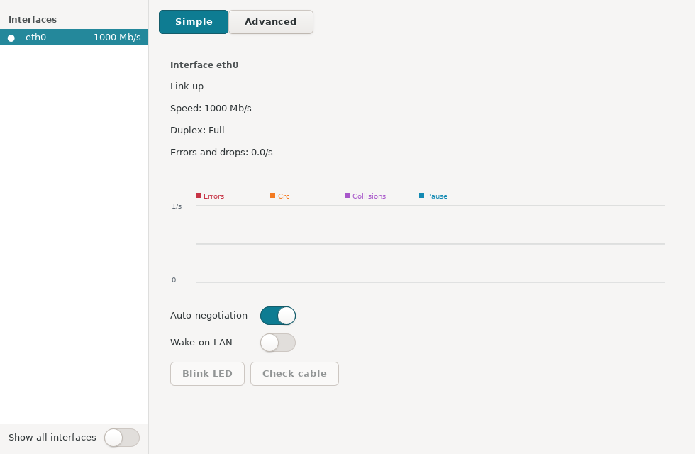
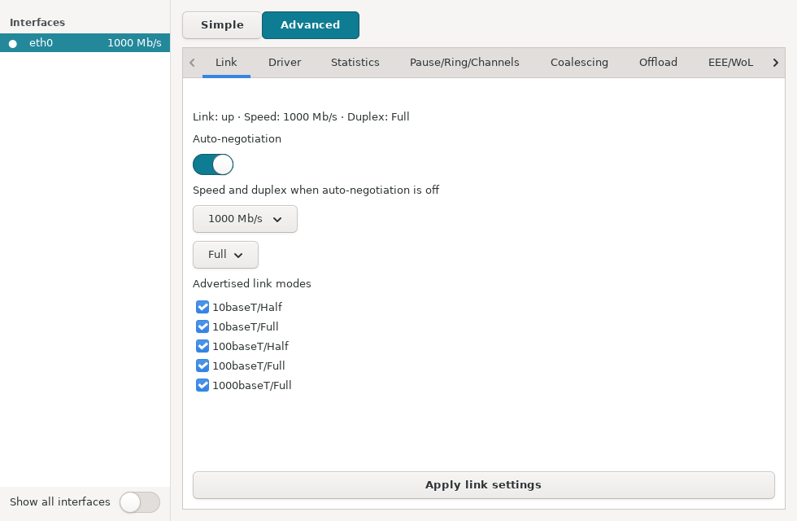

# ethtool-GUI

**ethtool-GUI** is a GTK desktop interface for inspecting and configuring Ethernet interfaces on Debian and SysLinuxOS. Read operations run as your user; changes request authorization through polkit.





## Features

- **Simple:** link state, speed, duplex, autonegotiation, error rates, Wake-on-LAN, LED identification, cable check and diagnostic suggestions.
- **Advanced:** advertised link modes, driver details, live statistics, pause, ring buffers, channels, coalescing, offloads, EEE, Wake-on-LAN, RSS and optical module data.
- **Tools:** supported hardware self-tests, raw dumps, snapshots and comparison of interface settings.
- **Link safety:** a 15-second confirmation lets you keep a new link setting. Otherwise the previous setting is restored. Confirmed changes can be saved for boot where NetworkManager or systemd supports them.

Available controls depend on the network card, driver and module. Unsupported capabilities are shown with an explanation. Cable tests and offline self-tests can interrupt connectivity.

## Installation

On Debian 13, SysLinuxOS or a compatible system, add the [SysLinuxOS-Tools APT repository](https://github.com/fconidi/SysLinuxOS-Tools#installation-client-side), then run:

```bash
sudo apt update
sudo apt install ethtool-gui
```

Alternatively, download the `.deb` from [Releases](https://github.com/fconidi/ethtool-GUI/releases) and install it with `sudo apt install ./ethtool-gui_<version>_all.deb`.

The package requires Python 3.11 or newer, GTK 3, `ethtool`, polkit and systemd. NetworkManager is recommended for saving settings on interfaces it manages. The interface is available in English, Italian, French, German and Spanish.

## Usage

Launch **ethtool-GUI** from the SysLinuxOS Tools menu or run `ethtool-gui`. Select a wired interface in the left pane. Simple shows its current state and common controls; Advanced opens the detailed tabs. Choose a control, review the requested operation and authorize it when prompted. For a link change, confirm **Keep** within 15 seconds if the new connection works. Use **Keep and save for boot** when you also want the setting after restart.

For Wake-on-LAN or module details, use the explicit authorized read control when ordinary user access cannot return the information. Snapshots are stored in your user data directory and can be compared or exported as text.

## Build

With `dpkg-deb` installed, run `python3 build-deb.py --output-dir /path/to/output`. The package is written to that directory.

## License

GPL-3.0. See [LICENSE](LICENSE).
